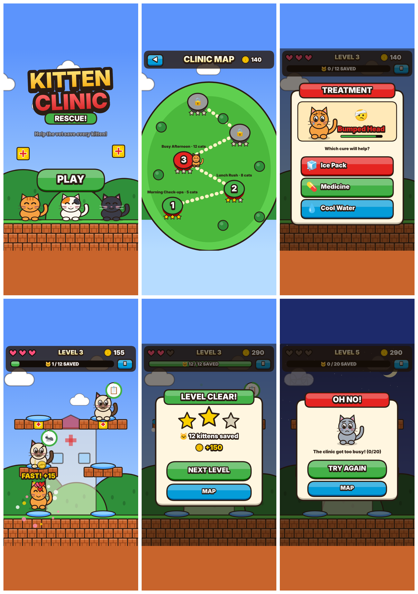

# Kitten Clinic Rescue — Design Draft 1

> Working title. A playable draft lives in `index.html`. Open it in a browser, or on a phone in portrait.

## 1. Concept

You are the vet at a busy kitten clinic. Sick kittens drop onto cushions around the clinic. Each one shows what's wrong in a speech bubble. Tap a kitten and pick the right cure from **3 options**. A healed kitten leaps away happy, and the next patient arrives right away. Save enough kittens to clear the level.

**Core loop (about 2 seconds per cat):** spot a bubble → tap the kitten → read the ailment → pick 1 of 3 cures → see hearts and coins pop → the next kitten drops in.

## 2. Rules (draft)

| | |
|---|---|
| **Lives** | 3 hearts per level |
| **Wrong cure** | −1 heart, and the kitten loses 15% patience |
| **Patience runs out** | The kitten goes "to the big hospital" 🚑 (−1 heart). No sad outcomes, so it stays kid-friendly |
| **Win** | Save the level's goal number of kittens |
| **Stars** | 3 = no hearts lost · 2 = 1 lost · 1 = cleared |
| **Coins** | +10 per save, +5 "FAST!" bonus if cured with more than 60% patience left |

## 3. The five levels

| Lvl | Name | Kittens to save | Max on screen | Patience | New ailments |
|---|---|---|---|---|---|
| 1 | Morning Check-ups | 5 | 2 | ~30 s | Hurt Paw, Sniffles, Very Hungry |
| 2 | Lunch Rush | 8 | 3 | ~25 s | + Itchy Fleas, Overheated |
| 3 | Busy Afternoon | 12 | 3 | ~21 s | + Bumped Head, Needs Vaccine |
| 4 | Sunset Surge 🌅 | 16 | 4 | ~18 s | + Tummy Ache |
| 5 | Night Shift 🌙 | 20 | 5 | ~15 s | + Shivering |

Difficulty rises in four ways at once: more kittens, more kittens at the same time, less patience, and more ailments to tell apart. All of these are one-line tweaks in the `LEVELS` table.

### Ailment → cure

| Ailment | Cure | Ailment | Cure |
|---|---|---|---|
| 🐾 Hurt Paw | 🩹 Bandage | 🤕 Bumped Head | 🧊 Ice Pack |
| 🤧 Sniffles | 💊 Medicine | 📋 Needs Vaccine | 💉 Vaccine |
| 🍽️ Very Hungry | 🐟 Fish Snack | 🤢 Tummy Ache | 🌿 Cat Grass |
| 🐜 Itchy Fleas | 🧴 Flea Shampoo | 🥶 Shivering | 🧣 Warm Blanket |
| 🥵 Overheated | 💧 Cool Water | | |

The two wrong options are always drawn from cures the player has already seen, so every choice is a real decision.

## 4. Visual direction: "modern platformer"

This takes the *feel* of a modern Mario-style game without using any Nintendo characters, names or assets. That keeps the App Store review clean, the same as the trademark cleanup in Slapshot Saga.

- **Palette:** saturated primaries. Sky blue `#5c94fc`, red `#e52521`, green `#43b047`, blue `#049cd8`, yellow `#fbd000`, brick `#c8642c`.
- **Chunky ink outlines** (`#2b1d14`) on everything, and big rounded heavy type with a thick stroke.
- **World:** brick platforms, a grassy ground strip, rolling hills, drifting outlined clouds.
- **Signature twist:** a yellow **medical-cross block** instead of a "?" block, and **paw-print coins**.
- **3D pill buttons** with a darker base and a glossy top half.
- **Juice:** squash-and-stretch landings, hop-and-leap exits, heart and coin bursts, floating "FAST! +15" text, screen shake on mistakes.
- **Level map:** an island with a dotted path and 5 level nodes with stars, like a platformer world map.
- **Time of day per level:** day → sunset → night, which shows progress visually.
- **Cats:** 7 coat types (tabby, gray, black, white, calico, siamese, tuxedo). Moods change with patience: neutral → worried with a tear → happy on cure.

## 5. Tech: same build as Slapshot Saga

- One self-contained `index.html`: vanilla JS and `<canvas>`, no frameworks, no image assets. Everything is drawn in code, and sounds are WebAudio chiptune blips.
- 480×720 logical canvas, scaled to fit the screen, sharp on retina displays (DPR), and safe-area padding for the notch.
- Same patterns as Slapshot Saga: a `C` config object, `Anims`, `Audio`, `Renderer` and `Game` classes, and a state machine (`menu → map → intro → play ⇄ treat/pause → win/lose`).
- Saving uses the same `localStorage` + `window.webkit.messageHandlers.gameStorage` bridge, with its own key `kc_meta`.
- **Ready for Capacitor 7 iOS** like Slapshot Saga: add `package.json`, `capacitor.config.json` and `www/index.html`, then `npx cap add ios`.

## 6. Decisions for you (before step 2)

1. **Name:** keep "Kitten Clinic Rescue", or pick another?
2. **Art style:** keep the procedural vector cats (fast to change, tiny app), or commission/illustrate sprite art? Emoji icons are placeholders and should become custom icons before release.
3. **The vet:** add a visible vet character (mascot in the menu, hands/tools during treatment)? Right now the player is "first person".
4. **Timer pressure:** other kittens' timers keep running while the treatment popup is open (current). Should they pause instead, for a gentler, younger audience?
5. **Failure:** is a patience timer + 3 hearts right, or should it be fully relaxed with no fail state (younger kids)?
6. **Coins:** should coins buy something (cat accessories, clinic decorations, power-ups like "slow time")?
7. **Repo:** move into its own repository (recommended for a separate App Store app with its own bundle ID), or keep it in this folder?
8. **Tall phones:** the 2:3 canvas letterboxes on modern iPhones (the bars are colour-matched). Should step 2 extend the layout to fill 19.5:9 screens fully?
